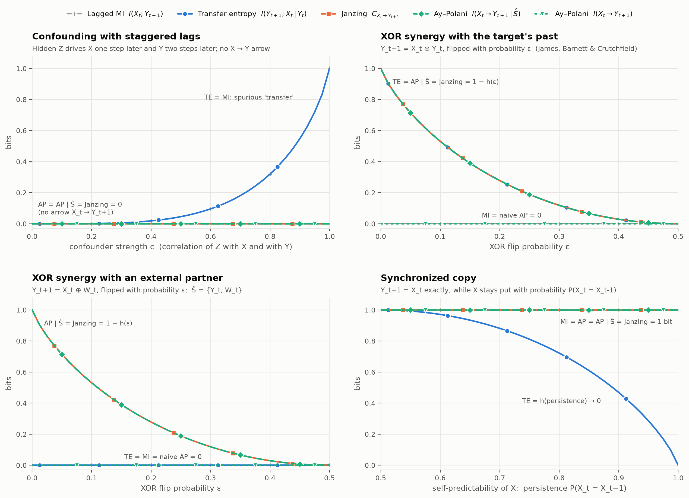
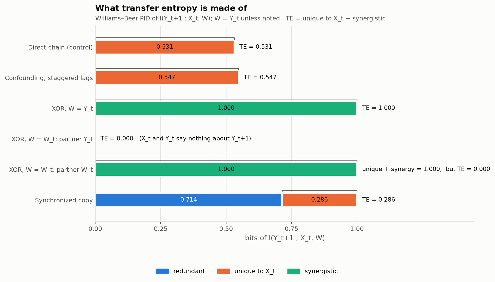
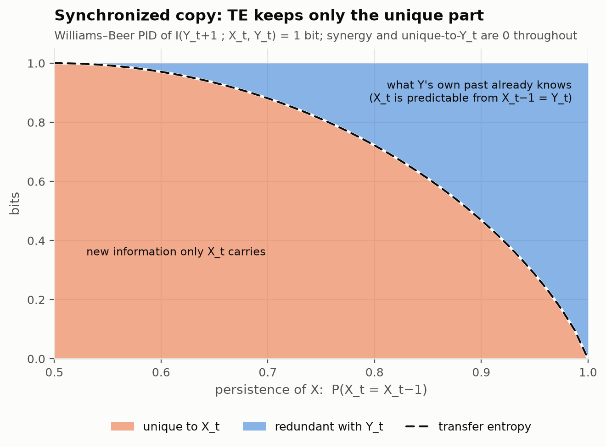
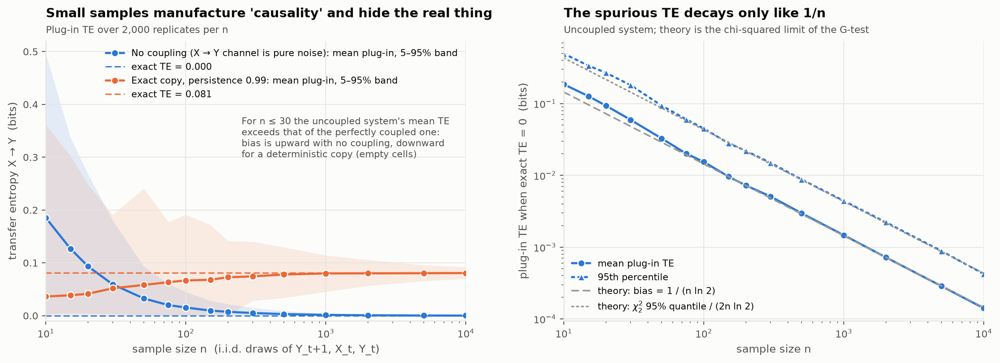

# Do information-theoretic causality measures agree?

An exact, enumeration-based testbed comparing three measures of "causal
influence" on small binary systems built to make them disagree:

| Measure | Foundation | Quantity for "does X_t influence Y_t+1?" |
|---|---|---|
| **Transfer entropy** (Schreiber 2000) | observational | TE = I(Y_t+1 ; X_t \| Y_t) |
| **Information flow** (Ay & Polani 2008) | interventional | I(X_t → Y_t+1) and I(X_t → Y_t+1 \| Ŝ) |
| **Causal strength** (Janzing et al. 2013) | edge-cutting | C = D(P ‖ P_{X_t→Y_t+1}) |

Every joint distribution is an explicit `dit.Distribution` over at most five
binary variables, so each number below is exact: no estimators, no sampling.
The only finite-sample numbers in the project are in the stretch goal that
studies estimation bias.

## The headline table

All values are in bits (`results/comparison_table.csv`; regenerate with
`uv run experiments/comparison_table.py`).

| System | Parameters | Arrow X_t→Y_t+1? | Imposed S | MI | TE | AP | AP \| Ŝ | Janzing |
| --- | --- | --- | --- | ---: | ---: | ---: | ---: | ---: |
| Direct chain (control) | noise=0.1 | yes | {Y_t} | 0.5310 | 0.5310 | 0.5310 | 0.5310 | 0.5310 |
| Confounding, staggered lags | strength=0.9 | no | {Y_t} | 0.5471 | 0.5471 | 0.0000 | 0.0000 | 0.0000 |
| ...same data, analyst's DAG (Z unobserved) | strength=0.9 | yes | {Y_t} | 0.5471 | 0.5471 | 0.5471 | 0.5471 | 0.5471 |
| XOR synergy, W = Y_t | noise=0 | yes | {Y_t} | 0.0000 | 1.0000 | 0.0000 | 1.0000 | 1.0000 |
| XOR synergy, W = W_t (external) | noise=0 | yes | {Y_t, W_t} | 0.0000 | 0.0000 | 0.0000 | 1.0000 | 1.0000 |
| Synchronized copy | persistence=0.95, copy_noise=0 | yes | {Y_t} | 1.0000 | 0.2864 | 1.0000 | 1.0000 | 1.0000 |

MI is the lagged mutual information I(X_t ; Y_t+1), included as an
observational baseline. AP is Ay–Polani flow with nothing imposed. AP | Ŝ
imposes S by intervention: the target's past, plus the target's other input
when it is observed.

### Reading the table

- **Direct chain (control).** Y_t+1 is a noisy copy of X_t, with no
  confounding and no synergy. All five quantities equal the channel's
  1 − h(0.1) = 0.531 bits, so the measures agree when nothing tricky is
  going on.
- **Confounding with staggered lags.** A hidden i.i.d. driver Z reaches X
  after one step and Y after two, so X_t "predicts" Y_t+1 without causing it.
  TE reports 0.547 bits = 1 − h((1 − c²)/2) of transfer. Both causal
  measures report exactly 0: there is no directed path X_t → Y_t+1, and
  intervening on X_t leaves Y_t+1 untouched.
- **...same data, analyst's DAG.** This row is the important caveat.
  Give Ay–Polani and Janzing the DAG an analyst would draw from X and Y
  alone (Y_t → X_t → Y_t+1 ← Y_t). Every measure then reproduces TE's
  false positive exactly. The causal measures beat TE on confounding only
  because they are handed the true DAG. Their advantage lies in the
  assumptions, not the formula.
- **XOR, W = Y_t** (Y_t+1 = X_t ⊕ Y_t; the example of James, Barnett &
  Crutchfield). X_t alone says nothing about Y_t+1 (MI = 0), and the naive
  flow is also 0. Once Y_t is conditioned on (TE) or imposed (AP | Ŝ), X_t
  carries a full bit, and Janzing's cut agrees. The numbers agree here, but
  the PID below shows that the bit TE reports is purely *synergistic*. It
  does not flow from X alone.
- **XOR, W = W_t external** (Y_t+1 = X_t ⊕ W_t). The same mechanism with
  a different partner makes TE miss the influence entirely (0 bits),
  because it conditions on Y_t, which is irrelevant here. Imposing W_t, or
  cutting the arrow, reveals the full bit.
- **Synchronized copy** (Y_t+1 = X_t exactly, and X is a slowly switching
  Markov chain). Coupling is perfect and every causal quantity is 1 bit. TE
  is only h(0.95) = 0.286 bits, because Y's own past Y_t = X_t−1 already
  predicts most of X_t. As persistence → 1, TE → 0: this is the
  synchronization example of Ay & Polani (also Janzing et al. §5.2).

## Parameter sweeps

`uv run experiments/parameter_sweeps.py` writes one figure and one CSV per
sweep to `results/sweep_plots/`, plus this overview:



The sweeps confirm that each disagreement is structural, not an artifact of
the chosen parameters:

- **Confounding:** TE grows with confounder strength c, while both causal
  measures stay flat at 0.
- **XOR (both variants):** noise ε lowers every nonzero quantity to
  1 − h(ε), and the zeros stay at zero.
- **Synchronized copy:** TE falls as h(persistence) while the causal
  measures stay at 1 bit.

## Stretch goal: what TE is made of (partial information decomposition)

`uv run experiments/pid_analysis.py` decomposes I(Y_t+1 ; X_t, W) with
`dit.pid`. In any PID, TE = I(Y_t+1 ; X_t | Y_t) = *unique to X_t* +
*synergy*, so the decomposition shows which kind of information TE counts
as transfer.



- **XOR, W = Y_t:** TE's bit is 100% synergy. Neither X_t nor Y_t carries
  any of it alone. TE assigns the bit to X, although it exists only in the
  pair; this is the mislocalization James et al. criticize.
- **XOR, W = W_t:** the bit is 100% synergy between X_t and W_t. TE's
  partner is Y_t, so it sees nothing.
- **Synchronized copy:** I(Y_t+1 ; X_t, Y_t) = 1 bit splits into redundancy
  (what Y's own past already knows) and unique information from X_t, and TE
  keeps only the unique part. The sweep below shows redundancy crowding out
  TE as X becomes self-predictable:

  

- **Confounding:** the spurious TE shows up as clean *unique* information
  from X_t. PID is observational too, so it cannot see the confounder.

Williams–Beer (I_min), MMI and BROJA agree on every system
(`results/pid/pid_table.csv`). BROJA is an optimization and lands within
1e-3 bits of the exact values. CCS is not guaranteed to be nonnegative, and on the copy
system it produces a negative unique atom (−0.166) balanced by the same
amount of synergy. TE = unique + synergy still holds for all four
variants, as it must.

## Stretch goal: finite-sample bias

`uv run experiments/finite_sample_te.py` draws n i.i.d. samples of
(Y_t+1, X_t, Y_t) from the exact distributions, evaluates TE on the
empirical distribution (the plug-in estimator, still computed by dit), and
repeats this 2,000 times per n.



- **With no coupling at all, the plug-in estimator still reports transfer:**
  0.19 bits on average at n = 10, and 0.015 bits at n = 100. The mean follows
  the first-order bias 1/(n ln 2), and the 95th percentile follows the χ²₂
  limit of the G-test, 5.99/(2n ln 2) bits. Any fixed threshold for
  "significant TE" therefore has to scale like 1/n.
- **The bias does not always point up.** For the deterministic copy
  (persistence 0.99, exact TE = 0.081), several cells of the joint are
  empty in small samples, and the estimate is biased *downward*. For
  n ≤ 30 the uncoupled system shows more average TE than the perfectly
  coupled one. Small samples both manufacture causality and hide it.

The samples are i.i.d., which is the best case: a real trajectory is
serially correlated and has fewer effective samples.

## How the measures are implemented

Everything is in `src/causality_measures/`. dit supplies the distribution
objects and every information quantity. The causal code only *builds* new
`dit.Distribution`s.

- **`do_operator.py`** computes `do(dist, dag, {node: value})` with the
  truncated factorization P(v | do(x)) = ∏_{i ∉ X} P(v_i | pa_i). Each
  mechanism P(v_i | pa_i) is read off the observational joint, and the
  product is assembled by `dit.distribution_from_bayesnet`. If an
  intervention needs a mechanism at a parent configuration of zero
  observational probability, the result is not identified from P, and a
  `PositivityError` is raised rather than a guessed value.
- **`measures.py`**
  - `transfer_entropy`: `dit.multivariate.coinformation(d, [[Y_t+1], [X_t]], [Y_t])`,
    the conditional mutual information.
  - `ay_polani_flow`: builds Ay & Polani's eq. (9),
    p̂(s, x, y) = p(s) · p(x | do(s)) · p(y | do(s), do(x)), with p(s) the
    *observational* marginal, then computes I_p̂(Y ; X | S) with dit.
  - `janzing_causal_strength`: builds the post-cutting distribution P_S of
    Definition 1, eq. (7). Each cut parent's open end is fed its own
    marginal, and several cut parents get the *product* of their marginals.
    It then computes D(P ‖ P_S) with
    `dit.divergences.kullback_leibler_divergence`.
  - `janzing_local_strength`: implements Lemma 3 (causal strength as local
    relative entropy) from the target's family alone. The tests check that
    it equals the global divergence.
- **`systems.py`** has one constructor per system. Each returns a
  `CausalSystem` with the exact joint, its DAG and the set S to impose.
  Every system is one time window of a stationary process, chosen so that
  it is causally closed: variables whose causes lie outside the window are
  independent roots with their exact stationary marginals. This makes both
  the window's joint distribution and interventions inside it exact.
- **`decomposition.py`** and **`estimation.py`** are thin layers over
  `dit.pid` and the plug-in estimator.

**A dit pitfall worth knowing.** `Distribution.marginal(names)` returns
variables in the distribution's *own* order, whatever order you request.
`condition_on` lists its conditioning marginal in that order but its
conditionals in the *requested* order. Relative entropy also compares
distributions positionally. The code therefore never relies on dit's
variable order: `joint_items` and `ordered_marginal` re-order by name, and
the regression tests use asymmetric systems where the orders differ.

## Tests

`uv run pytest` runs 85 checks, including the three sanity checks the
project asked for:

- TE equals mutual information when Y_t is uninformative;
- Janzing's strength is 0 when there is no arrow, and also when the arrow
  exists but the mechanism ignores it;
- all measures agree on an unconfounded, non-synergistic chain, at five
  noise levels.

The other checks:

- closed forms for every system across its parameter range;
- the back-door adjustment formula;
- positivity errors;
- Janzing's P1, Lemma 3, Theorem 4 and Remark 1;
- the Ay–Polani/Janzing synchronization example;
- the PID consistency equation TE = unique + synergy;
- convergence and bias of the plug-in estimator.

## Running it

Requires [uv](https://docs.astral.sh/uv/). `uv.lock` pins every dependency,
including dit 2.3 and its transitive dependencies.

```bash
uv sync                                   # create .venv from uv.lock
uv run pytest                             # 85 tests, ~5 s
uv run experiments/comparison_table.py    # table -> results/comparison_table.{csv,md}
uv run experiments/parameter_sweeps.py    # sweeps -> results/sweep_plots/
uv run experiments/pid_analysis.py        # PID -> results/pid/
uv run experiments/finite_sample_te.py    # bias study -> results/finite_sample/ (~1 min)
```

```
causality-measures/
├── src/causality_measures/
│   ├── do_operator.py     # DAG utilities, mechanisms, do()
│   ├── measures.py        # TE, Ay–Polani flow, Janzing strength (global + Lemma 3)
│   ├── systems.py         # the canonical systems + the analyst's-DAG view
│   ├── compare.py         # all measures on one system
│   ├── decomposition.py   # PID via dit.pid
│   └── estimation.py      # plug-in TE and its bias theory
├── experiments/           # comparison_table, parameter_sweeps, pid_analysis, finite_sample_te
├── tests/
└── results/
```

## Slides

`slides/slides.pdf` is a 37-page Beamer deck presenting these results to
students with no prior information theory or causal inference. It starts
with primers on bits and on interventions, then works through the three
measures and the systems where they disagree. Rebuild it with:

```bash
uv run experiments/slide_figures.py   # slide-sized figures from results/
cd slides && tectonic slides.tex      # or: latexmk -xelatex slides.tex
```

## References

1. Schreiber, T. (2000). Measuring information transfer. *Phys. Rev. Lett.* 85, 461–464.
2. Ay, N. & Polani, D. (2008). Information flows in causal networks. *Adv. Complex Syst.* 11, 17–41.
3. Janzing, D., Balduzzi, D., Grosse-Wentrup, M. & Schölkopf, B. (2013). Quantifying causal influences. *Ann. Stat.* 41, 2324–2358.
4. James, R. G., Barnett, N. & Crutchfield, J. P. (2016). Information flows? A critique of transfer entropies. *Phys. Rev. Lett.* 116, 238701.
5. Williams, P. L. & Beer, R. D. (2010). Nonnegative decomposition of multivariate information. arXiv:1004.2515.
